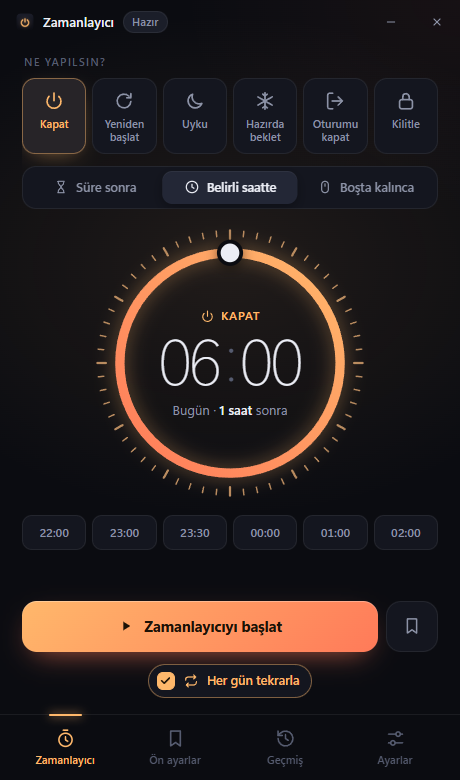
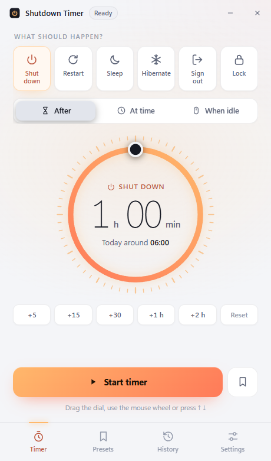
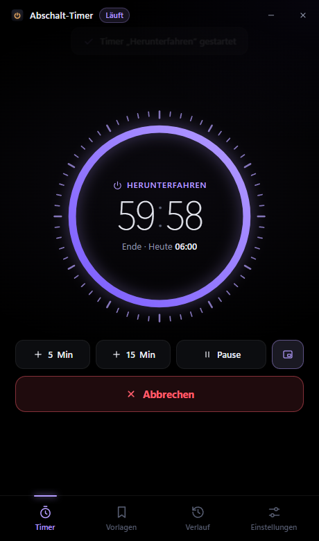
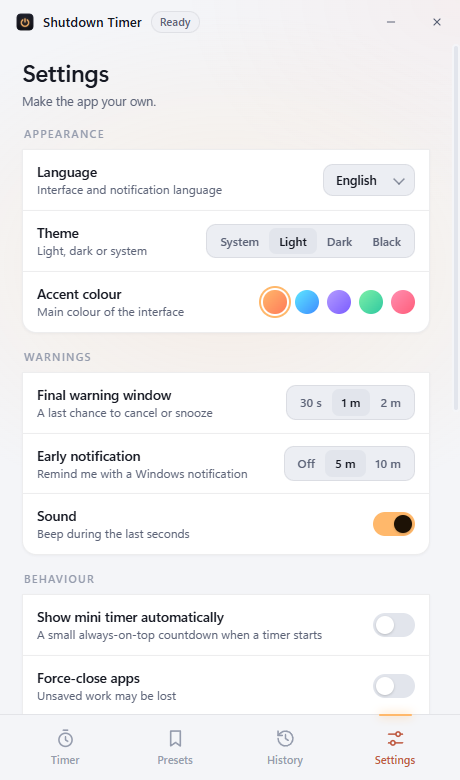
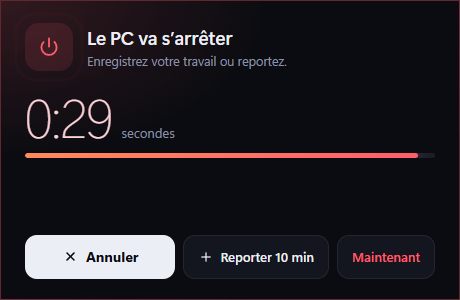

<div align="center">


# Zamanlayıcı

**Windows için zamanlı kapatma, yeniden başlatma, uyku ve kilitleme aracı.**
Açık kaynak, kurulum gerektirmez, reklamsız, veri toplamaz.

[](https://github.com/furkibayashi/zamanlayici/actions/workflows/release.yml)
[](https://github.com/furkibayashi/zamanlayici/releases/latest)
[](LICENSE)

**[⬇️ Son sürümü indir](https://github.com/furkibayashi/zamanlayici/releases/latest)** · [Güvenlik](#guvenlik) · [English](#english)

 

</div>

## ✨ Özellikler

| | |
|---|---|
| **6 eylem** | Kapat · Yeniden başlat · Uyku · Hazırda beklet · Oturumu kapat · Kilitle |
| **3 mod** | *Süre sonra* (ör. 45 dk) · *Belirli saatte* (ör. 23:30, istenirse **her gün**) · *Boşta kalınca* (fare/klavye X dk kullanılmazsa) |
| **Sürüklenebilir kadran** | Bir tam tur = 1 saat. Fare tekerleği ve ↑ ↓ tuşları da çalışır |
| **Son uyarı penceresi** | Eylemden önce her pencerenin üstünde geri sayım: *İptal* · *10 dk ertele* · *Şimdi* |
| **Mini sayaç** | Her zaman üstte duran küçük geri sayım penceresi |
| **Sistem tepsisi** | Kapatınca arka planda çalışır; tepsiden hızlı başlat, ertele, iptal et |
| **Ön ayarlar** | "Film gecesi", "İndirme bitince" gibi zamanlayıcıları tek tıkla başlat |
| **Geçmiş** | Hangi zamanlayıcı uygulandı, iptal edildi veya atlandı |
| **5 dil** | Türkçe · English · Deutsch · Español · Français |
| **4 tema + 5 renk** | Sistem · Açık · Koyu · Siyah (OLED) |
| **Kısayollar** | `Ctrl+Alt+Z` göster/gizle · `Ctrl+Alt+X` iptal · `Enter` başlat · `1`–`6` eylem seç |
| **Akıllı güvenlik** | Bilgisayar uykudayken saat geçtiyse uyanınca kapatmaz; çıkarken zamanlayıcıyı Windows'a devredebilir |

<div align="center">


<br>

<br>

</div>

## ⬇️ Kurulum

1. [Releases](https://github.com/furkibayashi/zamanlayici/releases/latest) sayfasından `Zamanlayici-x.y.z.exe` dosyasını indirin.
2. Çift tıklayın. Kurulum yok, yönetici izni gerekmez.

> **Windows "bilgisayarınız korundu" (SmartScreen) uyarısı gösterirse:** Bu, dosyanın virüslü olduğu anlamına gelmez; uygulama ücretli bir kod imzalama sertifikasıyla imzalanmadığı ve henüz yeterince indirilmediği için çıkar. **Ek bilgi → Yine de çalıştır** deyin. Önce aşağıdaki adımlarla doğrulamanızı öneririm.

<a id="guvenlik"></a>
## 🛡️ Virüs değil mi? (Güvenlik)

Hiçbir yazılım için "%100 virüssüz" diye mutlak bir kanıt verilemez; ama bu uygulamanın ne yaptığını **kendiniz doğrulayabilmeniz** için her şey açık:

### 1. Kodun tamamı burada ve okunabilir
Uygulama yaklaşık 3.500 satır, sıkıştırılmamış, okunabilir JavaScript/HTML/CSS'ten oluşur. Gizli veya karıştırılmış (obfuscated) kod yoktur.

| Dosya | Görevi |
|---|---|
| [`main.js`](main.js) | Zamanlayıcı mantığı, pencereler, tepsi, Windows komutları |
| [`preload.js`](preload.js) | Arayüzle ana süreç arasındaki dar, güvenli köprü |
| [`src/`](src) | Arayüz (HTML/CSS/JS) ve dil dosyası |
| [`scripts/make-icons.js`](scripts/make-icons.js) | Simgeleri kod ile çizer (dışarıdan dosya indirmez) |

### 2. Exe benim bilgisayarımda değil, GitHub'da derleniyor
Her sürüm, [GitHub Actions](.github/workflows/release.yml) tarafından bu depodaki koddan **GitHub'ın sunucularında** derlenir. Derleme kayıtları [herkese açıktır](https://github.com/furkibayashi/zamanlayici/actions). Yani indirdiğiniz exe, burada gördüğünüz kodun birebir derlenmiş halidir.

### 3. GitHub imzalı köken kanıtı (build provenance)
Her exe için GitHub, "bu dosya şu depodaki şu commit'ten şu iş akışıyla üretildi" diyen **kriptografik olarak imzalı** bir kanıt üretir. Doğrulamak için ([GitHub CLI](https://cli.github.com/) gerekir):

```powershell
gh attestation verify .\Zamanlayici-2.1.0.exe -R furkibayashi/zamanlayici
```

Dosyada tek bir bayt bile değişmişse doğrulama başarısız olur. Kanıtlar: [Attestations](https://github.com/furkibayashi/zamanlayici/attestations).

### 4. SHA-256 özeti
Her sürümde `SHA256SUMS.txt` bulunur. İndirdiğiniz dosyanın özetini karşılaştırın:

```powershell
Get-FileHash .\Zamanlayici-2.1.0.exe -Algorithm SHA256
```

### 5. VirusTotal
Exe'yi [VirusTotal](https://www.virustotal.com/)'e yükleyip 70'ten fazla antivirüs motoruyla tarayabilirsiniz.

### 6. Uygulama tam olarak ne yapıyor?

- **Çalıştırdığı komutlar** (sadece Windows'un kendi araçları, yalnızca siz bir zamanlayıcı kurduğunuzda):

  | Eylem | Komut |
  |---|---|
  | Kapat | `shutdown /s /t 0` |
  | Yeniden başlat | `shutdown /r /t 0` |
  | Oturumu kapat | `shutdown /l` |
  | Hazırda beklet | `shutdown /h` |
  | Kilitle | `rundll32.exe user32.dll,LockWorkStation` |
  | Uyku | PowerShell: `[System.Windows.Forms.Application]::SetSuspendState('Suspend', ...)` |

- **İnternet:** Tek bir ağ isteği vardır: açılışta `api.github.com` üzerinden bu deponun son sürüm numarasını okumak. Hiçbir veri gönderilmez. **Ayarlar → Güncellemeleri denetle** ile tamamen kapatılabilir.
- **Veri:** Ayarlar, ön ayarlar ve geçmiş yalnızca bilgisayarınızda, `%APPDATA%\Zamanlayici\zamanlayici.json` dosyasında tutulur. Telemetri, analiz, reklam yoktur.
- **İzinler:** Yönetici izni istemez; dosyalarınızı okumaz; arka planda başka program indirmez veya çalıştırmaz.
- **Electron güvenliği:** `contextIsolation`, `sandbox`, `nodeIntegration: false`, sıkı Content-Security-Policy, uzak içerik yüklenmez, yeni pencere/sayfa açılması engellidir.

Bir güvenlik sorunu bulursanız lütfen [SECURITY.md](SECURITY.md)'deki adımları izleyin.

## 🛠️ Kaynaktan derleme

[Node.js](https://nodejs.org/) 20+ gerekir.

```bash
git clone https://github.com/furkibayashi/zamanlayici.git
cd zamanlayici
npm install
npm start            # uygulamayı çalıştır
npm run start:test   # deneme modu: hiçbir eylem gerçekten uygulanmaz, sadece loglanır
npm run build        # dist/ klasörüne taşınabilir exe üretir
```

## 🌍 Çeviri eklemek
Tüm metinler [`src/i18n.js`](src/i18n.js) dosyasında. Yeni bir dil için `tr` bloğunu kopyalayıp çevirin ve `LANGS` listesine ekleyin. Pull request'ler memnuniyetle karşılanır.

---

<a id="english"></a>
## English

**Zamanlayıcı** ("Timer") is a free, open-source, portable Windows app that shuts down, restarts, sleeps, hibernates, signs out or locks your PC **after a duration**, **at a set time** (optionally every day) or **after the PC has been idle** for a while.

- 5 languages (TR, EN, DE, ES, FR), 4 themes, 5 accent colours
- Final warning window with cancel / snooze, always-on-top mini timer, tray menu, presets, history
- **Is it safe?** Every release is built from this public source by GitHub Actions and carries a signed build-provenance attestation. Verify with
  `gh attestation verify Zamanlayici-2.1.0.exe -R furkibayashi/zamanlayici` and compare the SHA-256 in `SHA256SUMS.txt`.
  The only network request is an optional update check to `api.github.com`; no data is collected. See the [security section](#guvenlik) for the exact commands it runs.

## Lisans
[MIT](LICENSE) © 2026 furkibayashi
